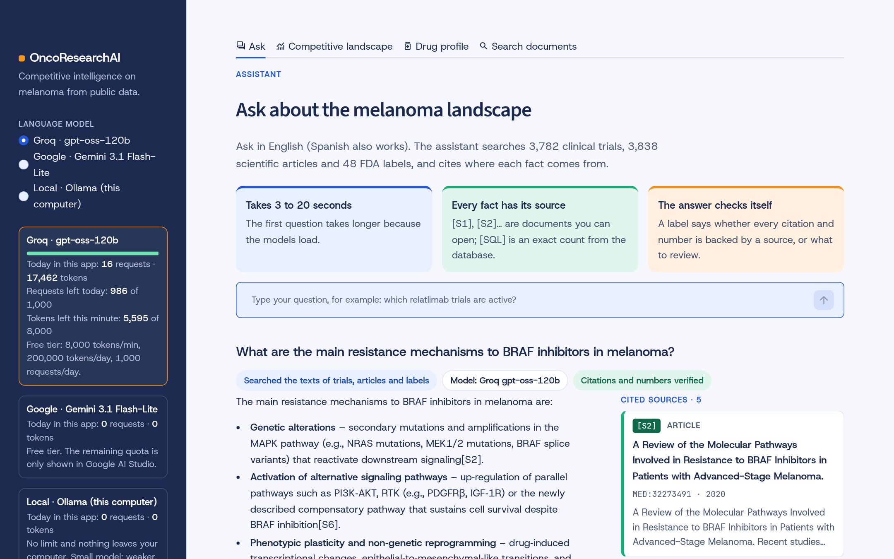
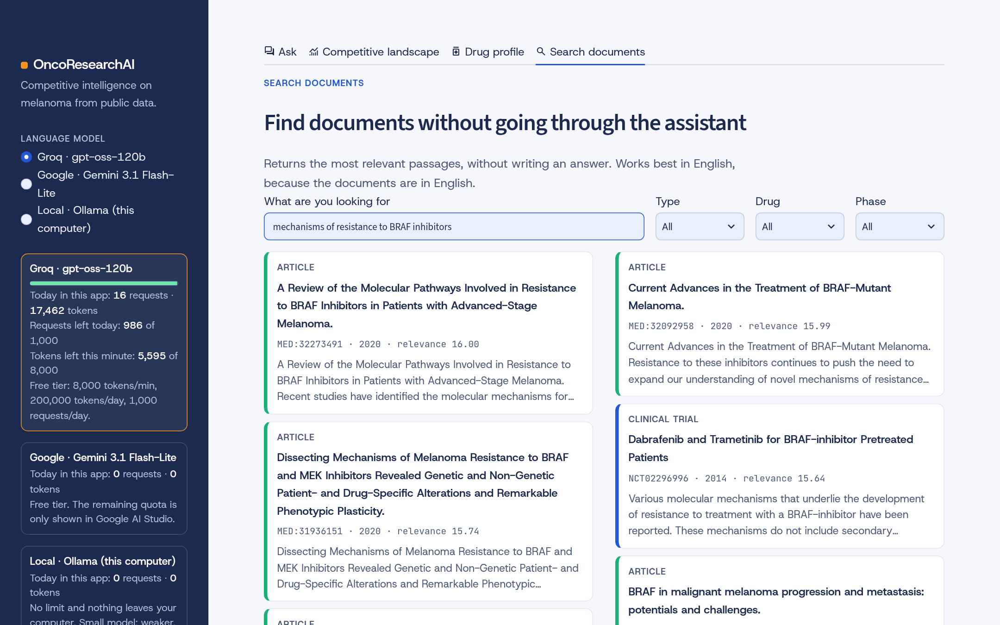
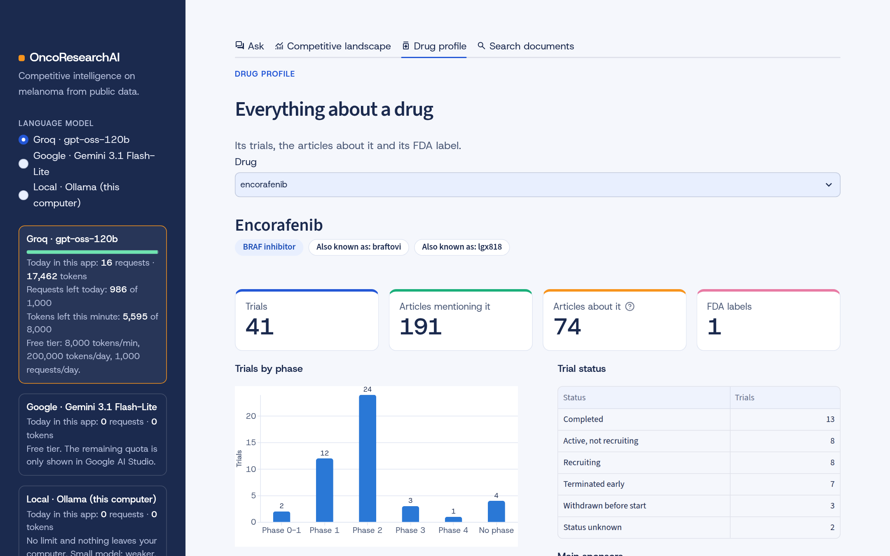

# OncoResearchAI

**A research assistant for melanoma drugs: ask a question in plain language and get an answer
built from scientific literature, clinical trials and FDA labels, with every claim cited.**

Evidence about melanoma treatments is spread across many public sources: papers in PubMed and
Europe PMC, trial records in ClinicalTrials.gov, official drug labels, congress abstracts. Each
source has its own format, and the same drug appears under several names (a single drug can be
"pembrolizumab", "Keytruda" or "MK-3475"), so finding and cross-checking what is known about a
treatment takes a lot of manual work.

This project collects those sources, links them through the drugs they mention, and puts an AI
assistant on top that can answer questions such as:

> "What are the main mechanisms of resistance to BRAF inhibitors?"
> "What adverse reactions does the Braftovi FDA label describe?"
> "Which active phase 3 trials include encorafenib, and what do they compare?"
> "Which anti-PD-1 drug has the most phase 3 trials?"

Questions about **literature and labels** are answered by reading the relevant passages;
questions about **counts and lists** (trials by phase, status or sponsor) are answered with an
exact database query; many questions need both. Either way, **every claim cites its source**
(paper, trial, FDA label or congress PDF) with a link, and the answer is checked automatically
against those sources.

The starting scope is melanoma and 10 reference drugs covering targeted therapy (BRAF/MEK
inhibitors) and immunotherapy (anti-PD-1, anti-CTLA-4, anti-LAG-3). The scope lives in a single
file (`ingestion/landscape.py`), so it can be changed to other conditions or drugs. The same
data also powers a competitive-landscape view (who is running which trials) for pharma
analysts.

> Status: **working end to end** (see the [roadmap](docs/DOCUMENTATION.md#roadmap)). Pending items that need human review: measuring
> the AI extractor against a hand-annotated sample and reviewing the evaluation set.

## How it works

```
 Public sources            Catalog                         Assistant                 Usage
┌──────────────────┐   ┌──────────────────┐   ┌──────────────────────────────┐   ┌───────────┐
│ ClinicalTrials   │   │ Postgres         │   │ 1. Plan: exact data (SQL)    │   │ Streamlit │
│ Europe PMC       │──►│ (tables + links) │──►│    or content (search)?      │──►│ REST API  │
│ openFDA          │   │ Qdrant (vectors) │   │ 2. Search / query            │   │ MCP       │
│ Congress PDFs    │   │ BM25 (keywords)  │   │ 3. Answer citing [S1]        │   │ (agents)  │
└──────────────────┘   └──────────────────┘   │ 4. Verify citations, numbers │   └───────────┘
                                              └──────────────────────────────┘
```

- **Postgres (relational database):** answers exact questions ("how many phase 3 trials are
  recruiting?") with SQL that the agent writes and that is validated before it runs.
- **Qdrant + BM25 (hybrid search):** finds texts by meaning *and* by exact words (drug names,
  codes such as MK-3475), and a reranker reorders the best candidates.
- **The agent (LangGraph)** decides what to use, answers only from what it found, and checks
  that every citation exists and every number appears in the sources; if not, it rewrites the
  answer.

## Screenshots

**Ask: a question answered from the literature.** The answer cites numbered sources on the
right, each one a paper, trial or label you can open; a badge says whether every citation and
number was verified.



**Ask: a question answered with an exact database query.** For counts and lists the agent
writes SQL (validated and read-only); the SQL can be inspected to check the result.


**Search documents.** The hybrid search on its own, with filters by source type, drug and
phase, without generating an answer.



**Drug profile.** Everything known about one drug: its trials by phase and status, articles
about it, sponsors and FDA label.



**Competitive landscape.** Key figures, active trials per drug, drug × phase map, trials per
year and the companies running the most trials.


## Source data

| Source | What it provides | Records |
|---|---|---|
| [ClinicalTrials.gov](https://clinicaltrials.gov) | Clinical trials: phase, status, sponsor, treatments | 3,782 |
| [Europe PMC](https://europepmc.org) | Scientific papers: title, abstract, journal, year | 3,838 (after removing duplicates) |
| [openFDA](https://open.fda.gov) | Official drug labels of approved drugs | 48 |
| [ChEMBL](https://www.ebi.ac.uk/chembl/) | Alternative names for each drug | Optional (unstable server) |
| Congress PDFs | Results not yet published, added by hand | Ready to use (`data/manual_pdfs/`) |

Scope: melanoma and 10 drugs (encorafenib, binimetinib, dabrafenib, trametinib, vemurafenib,
cobimetinib, pembrolizumab, nivolumab, ipilimumab, relatlimab). Why these sources and not
others: [`docs/decisions/0001-data-sources.md`](docs/decisions/0001-data-sources.md).

## How to run it

You need Docker, [`uv`](https://docs.astral.sh/uv/), Python 3.12, an NVIDIA GPU (recommended,
not required) and a free Groq key ([console.groq.com](https://console.groq.com)).

```bash
cp .env.example .env     # fill in the Postgres password and GROQ_API_KEY (and GEMINI_API_KEY, optional)
make install             # dependencies
make pipeline            # Docker + download + load into Postgres + quality + indexes (~15 min)
make api                 # terminal 1: API at http://localhost:8000/docs
make ui                  # terminal 2: interface at http://localhost:8501
```

`make help` lists all the commands (evaluations, PDFs, MCP, tests...). The first question is
slower because it downloads and loads the Hugging Face models.

**Using it from Claude (MCP).** The MCP server exposes 5 tools (`search_evidence`,
`query_trials`, `get_drug_profile`, `get_landscape`, `ask`). In Claude Code:

```bash
claude mcp add oncoresearchai -- uv --directory /path/to/OncoResearchAI run python -m onco_research_ai.mcp_server.server
```

In Claude Desktop, in `claude_desktop_config.json`:

```json
{"mcpServers": {"oncoresearchai": {"command": "uv", "args": ["--directory", "/path/to/OncoResearchAI",
  "run", "python", "-m", "onco_research_ai.mcp_server.server"]}}}
```

**Adding congress PDFs:** copy the PDFs into `data/manual_pdfs/`, optionally add a
`metadata.csv` (`file,title,congress,year,url`), and run `make pdfs`.

## More documentation

Evaluation results, roadmap, project structure, a phase-by-phase write-up of how it was built
and glossaries are in [`docs/DOCUMENTATION.md`](docs/DOCUMENTATION.md). The reasons for each
source and tool choice are in [`docs/decisions/`](docs/decisions/).
