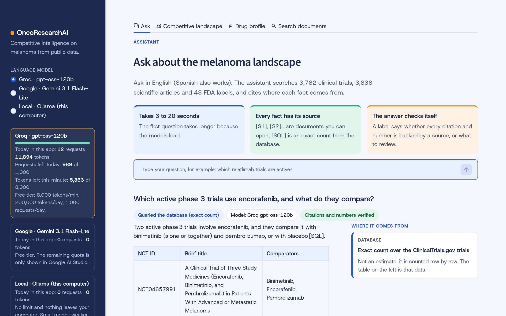
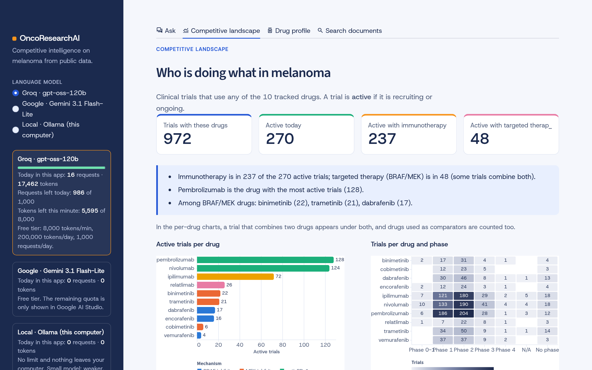

# OncoResearchAI

**A research assistant for melanoma drugs: ask a question in plain language and get an answer
built from scientific literature, clinical trials and FDA labels, with every claim cited.**

Evidence about melanoma treatments is spread across many public sources: papers in PubMed and
Europe PMC, trial records in ClinicalTrials.gov, official drug labels, congress abstracts. Each
source has its own format, and the same drug appears under several names (a single drug can be
"pembrolizumab", "Keytruda" or "MK-3475"), so finding and cross-checking what is known about a
treatment takes a lot of manual work.

This project collects those sources, links them through the drugs they mention, and puts an AI
assistant on top that can answer questions such as:

> "What are the main mechanisms of resistance to BRAF inhibitors?"
> "What adverse reactions does the Braftovi FDA label describe?"
> "Which active phase 3 trials include encorafenib, and what do they compare?"
> "Which anti-PD-1 drug has the most phase 3 trials?"

Questions about **literature and labels** are answered by reading the relevant passages;
questions about **counts and lists** (trials by phase, status or sponsor) are answered with an
exact database query; many questions need both. Either way, **every claim cites its source**
(paper, trial, FDA label or congress PDF) with a link, and the answer is checked automatically
against those sources.

The starting scope is melanoma and 10 reference drugs covering targeted therapy (BRAF/MEK
inhibitors) and immunotherapy (anti-PD-1, anti-CTLA-4, anti-LAG-3). The scope lives in a single
file (`ingestion/landscape.py`), so it can be changed to other conditions or drugs. The same
data also powers a competitive-landscape view (who is running which trials) for pharma
analysts.

> Status: **working end to end** (phases 0-10). Pending items that need human review: measuring
> the AI extractor against a hand-annotated sample and reviewing the evaluation set.

## How it works

```
 Public sources            Catalog                         Assistant                 Usage
┌──────────────────┐   ┌──────────────────┐   ┌──────────────────────────────┐   ┌───────────┐
│ ClinicalTrials   │   │ Postgres         │   │ 1. Plan: exact data (SQL)    │   │ Streamlit │
│ Europe PMC       │──►│ (tables + links) │──►│    or content (search)?      │──►│ REST API  │
│ openFDA          │   │ Qdrant (vectors) │   │ 2. Search / query            │   │ MCP       │
│ Congress PDFs    │   │ BM25 (keywords)  │   │ 3. Answer citing [S1]        │   │ (agents)  │
└──────────────────┘   └──────────────────┘   │ 4. Verify citations, numbers │   └───────────┘
                                              └──────────────────────────────┘
```

- **Postgres (relational database):** answers exact questions ("how many phase 3 trials are
  recruiting?") with SQL that the agent writes and that is validated before it runs.
- **Qdrant + BM25 (hybrid search):** finds texts by meaning *and* by exact words (drug names,
  codes such as MK-3475), and a reranker reorders the best candidates.
- **The agent (LangGraph)** decides what to use, answers only from what it found, and checks
  that every citation exists and every number appears in the sources; if not, it rewrites the
  answer.

## Screenshots

**Ask: a question answered from the literature.** The answer cites numbered sources on the
right, each one a paper, trial or label you can open; a badge says whether every citation and
number was verified.


**Ask: a question answered with an exact database query.** For counts and lists the agent
writes SQL (validated and read-only); the SQL can be inspected to check the result.



**Search documents.** The hybrid search on its own, with filters by source type, drug and
phase, without generating an answer.


**Drug profile.** Everything known about one drug: its trials by phase and status, articles
about it, sponsors and FDA label.


**Competitive landscape.** Key figures, active trials per drug, drug × phase map, trials per
year and the companies running the most trials.



## Main results

| What was measured | Result | Detail |
|---|---|---|
| Search: correct document in the top 5 | **87%** (102 questions) | Phase 5 |
| Search: questions in Spanish | 74% (the agent translates to English before searching) | Phase 5 |
| Answers: correct figure on questions with a known answer | 4 of 4 | Phase 10 |
| Answers: claims supported by their sources (LLM judge) | 89% (12 questions) | Phase 10 |
| Response time | ~2 s search · ~5-20 s full answer | GTX 1650 + free Groq tier |

## Roadmap

| Phase | What is done | Status |
|---|---|---|
| 0 | Set up the environment and explore each data source | ✔ |
| 1 | Download all the data reliably | ✔ (ChEMBL optional, unstable server) |
| 2 | Organize the data into tables and link them together | ✔ |
| 3 | Data quality checks | ✔ (extractor still to be measured with manual annotation) |
| 4 | Index the texts in the vector database | ✔ MiniLM and MedCPT (bge-m3 optional) |
| 5 | Hybrid search and its evaluation | ✔ |
| 6 | Answers with source citations | ✔ |
| 7 | Agent that chooses how to search (LangGraph) | ✔ |
| 8 | REST API and MCP server | ✔ |
| 9 | Streamlit interface | ✔ |
| 10 | Answer evaluation + congress PDFs | ✔ |

## Source data

| Source | What it provides | Records |
|---|---|---|
| [ClinicalTrials.gov](https://clinicaltrials.gov) | Clinical trials: phase, status, sponsor, treatments | 3,782 |
| [Europe PMC](https://europepmc.org) | Scientific papers: title, abstract, journal, year | 3,838 (after removing duplicates) |
| [openFDA](https://open.fda.gov) | Official drug labels of approved drugs | 48 |
| [ChEMBL](https://www.ebi.ac.uk/chembl/) | Alternative names for each drug | Optional (unstable server) |
| Congress PDFs | Results not yet published, added by hand | Ready to use (`data/manual_pdfs/`) |

Scope: melanoma and 10 drugs (encorafenib, binimetinib, dabrafenib, trametinib, vemurafenib,
cobimetinib, pembrolizumab, nivolumab, ipilimumab, relatlimab). Why these sources and not
others: [`docs/decisions/0001-data-sources.md`](docs/decisions/0001-data-sources.md).

## How to run it

You need Docker, [`uv`](https://docs.astral.sh/uv/), Python 3.12, an NVIDIA GPU (recommended,
not required) and a free Groq key ([console.groq.com](https://console.groq.com)).

```bash
cp .env.example .env     # fill in the Postgres password and GROQ_API_KEY (and GEMINI_API_KEY, optional)
make install             # dependencies
make pipeline            # Docker + download + load into Postgres + quality + indexes (~15 min)
make api                 # terminal 1: API at http://localhost:8000/docs
make ui                  # terminal 2: interface at http://localhost:8501
```

`make help` lists all the commands (evaluations, PDFs, MCP, tests...). The first question is
slower because it downloads and loads the Hugging Face models.

**Using it from Claude (MCP).** The MCP server exposes 5 tools (`search_evidence`,
`query_trials`, `get_drug_profile`, `get_landscape`, `ask`). In Claude Code:

```bash
claude mcp add oncoresearchai -- uv --directory /path/to/OncoResearchAI run python -m onco_research_ai.mcp_server.server
```

In Claude Desktop, in `claude_desktop_config.json`:

```json
{"mcpServers": {"oncoresearchai": {"command": "uv", "args": ["--directory", "/path/to/OncoResearchAI",
  "run", "python", "-m", "onco_research_ai.mcp_server.server"]}}}
```

**Adding congress PDFs:** copy the PDFs into `data/manual_pdfs/`, optionally add a
`metadata.csv` (`file,title,congress,year,url`), and run `make pdfs`.

## Project structure

```
src/onco_research_ai/
  ingestion/    download from each source (one connector per API) and congress PDFs
  processing/   cleaning, validation, drug dictionary, chunking and AI extractor
  storage/      Postgres tables, data loading, fixed queries and Qdrant access
  quality/      data quality checks
  retrieval/    embeddings, indexing, BM25, hybrid search and reranker
  llm/          single LLM client (LiteLLM: Groq, Gemini or local Ollama, with fallback and retries)
  agent/        LangGraph agent: safe SQL, citations and verification
  api/          REST API (FastAPI)
  mcp_server/   MCP server
  evaluation/   evaluation set and search and answer evaluations
app/            Streamlit interface
docs/decisions/ why each tool or source was chosen
eval/           evaluation set and generated reports (eval/reports/)
tests/          automated tests (pytest)
data/           downloaded data and indexes (not committed to git)
```

---

# Documentation by phase

## Phase 0 — Environment and exploration

**Goal:** set up the project and understand how each API responds before building anything.

- Python project with `uv` (dependencies), `ruff` (style) and `pytest` (tests); `.gitignore`
  keeps passwords (`.env`) and data (`data/`) out of git.
- `docker-compose.yml` starts Postgres and Qdrant with a single command.
- One quick test per source (`scripts/smoke_*.py`): a real query to see what the data looks like.

What was learned:

- Each API paginates differently: ClinicalTrials.gov with a token (`nextPageToken`), Europe PMC
  with a cursor (`cursorMark`), openFDA with an offset (`skip`/`limit`) and ChEMBL with a
  `page_meta` block.
- The data is dirty: results that are not melanoma, empty or `NA` trial phases, openFDA labels
  without a drug name, noisy ChEMBL synonyms.
- ChEMBL returns intermittent 500 errors.

## Phase 1 — Data download

**Goal:** turn the tests into a tool that downloads **all** the data, always the same way and
reliably.

```
landscape.py   → what we study: melanoma + 10 drugs
connector      → knows how to paginate that API (one per source)
http.py        → request with timeout and retries
raw_store.py   → saves each page as-is + a manifest.json
```

Main decisions:

- **Retries with growing wait times**, only for transient failures (5xx error, rate limit,
  network down). A 404 is not retried: repeating it does not fix it.
- **Raw data is never modified:** each download goes to a new folder in `data/raw/` and is never
  overwritten. If something goes wrong later, you can start over from there.
- **`manifest.json` with a status:** `complete` or `partial`. A folder without a manifest is an
  interrupted download; a `partial` one finished but with errors. Only the latest `complete`
  one is used.
- **Narrowed Europe PMC search:** from 69,852 papers (broad search, lots of noise) to 3,883
  (drug and melanoma in the title or abstract, from 2020 onward).
- **Tests with a fake HTTP server** to test pagination and retries without depending on the
  internet.

| Source | Records | Check |
|---|---|---|
| ClinicalTrials.gov | 3,782 | Matches the total the API reports, no duplicates |
| Europe PMC | 3,883 | No duplicates |
| openFDA | 48 | Matches the API total |
| ChEMBL | pending | Unstable server; if it does not respond, that source is simply not used |

**Difference between phases 0 and 1:**

| | Phase 0 (exploration) | Phase 1 (download) |
|---|---|---|
| Goal | Understand how each API responds | Download all the data |
| Volume | 5-10 sample records | Thousands of records |
| Pagination | 2 pages tested by hand | Automatic, until the end |
| Errors | It broke | Retries and download status |
| Usage | Loose scripts | One command |

## Phase 2 — Data model and alignment

**Goal:** convert the raw JSON files, each with its own format, into **a single catalog** where
information can be cross-referenced (trial ↔ drug ↔ paper).

### What each table contains and where it comes from

Each table is a list of things of the same type. The "junction tables" are lists that say "this
thing goes with that thing".

| Table | Origin | Example row |
|---|---|---|
| `trials`, `trial_interventions` | ClinicalTrials.gov (what the sponsor declares before the trial) | NCT04657991, phase 3; uses "Encorafenib" |
| `publications` | Europe PMC (bibliographic record: title, abstract, journal) | A paper with its PMID and DOI |
| `labels`, `label_sections` | openFDA (official label, split into sections) | BRAFTOVI label → "indications" section |
| `drugs`, `drug_synonyms` | **Written by hand** in `processing/drugs_seed.py` | encorafenib ← braftovi, lgx818 |
| `trial_drugs`, `publication_drugs`, `label_drugs`, `trial_publications` | **Computed** at load time by cross-referencing the above | NCT04657991 ↔ encorafenib |
| `publication_extractions` | **AI-generated** from each paper's abstract | A paper → n = 270, PFS = 14.9 months |

Each row stores in `source_run` the `data/raw/` folder it came from, so its origin can always
be traced.

### How the sources are linked

The three sources share no identifier, so the **drug acts as the join point**: each source is
connected to the `drugs` table through the data it does have.

```
Trial ───────► Drug      comparing its treatments with the drug's known names
Paper ───────► Drug      searching for those names in the title and abstract (in_title marks whether it is in the title)
FDA label ───► Drug      by the label's drug name; if missing, searching its text
Trial ◄────► Paper       through two routes (below)
```

Trial ↔ paper link, with two reliability levels (`link_type`):

- `trial_reference`: the trial itself lists the paper among its references (reliable).
- `abstract_mention`: the paper cites the trial's NCT code in its title or abstract (less reliable).

With this, a single join through `drugs` answers: "give me the trials, papers and labels of
pembrolizumab".

### Known limitations

- Only the 10 drugs in the dictionary are linked. Labels for other drugs (dacarbazine,
  atezolizumab...) stay unlinked: 34 of the 48.
- A paper linked through its abstract may mention the drug only in passing; that is why
  `in_title` exists.
- 21 of the 48 labels have no drug name as a separate field.

### The AI extractor and hallucinations

Some key data (number of patients, survival, treatment line) only appears inside the free text
of abstracts. A language model (Groq's `gpt-oss-120b`, through LiteLLM) reads them and fills in
a fixed form. But a model can **make up** a value, so there are three defenses:

1. The prompt requires `null` if the value does not appear.
2. Pydantic rejects values outside the form (for example, a non-existent treatment line).
3. Every figure returned must appear **literally** in the abstract; otherwise it is recorded in
   `unverified_fields`.

Real example: the CheckMate 067 study reports three groups (n = 314, 316 and 315) and the model
returned n = 945, their sum. That is correct, but it is not written anywhere, so it was flagged
as unverified. This table is not emptied when the data is reloaded, because each extraction
consumes API quota.

### Status

- [x] Data model and tables in Postgres
- [x] Load validated with Pydantic: 3,782 trials, 3,838 papers (after removing duplicates), 48 labels
- [x] Dictionary of 10 drugs (36 names) and links to trials, papers and labels
- [x] AI extractor tested on 47 papers
- [ ] Extend the dictionary with ChEMBL (optional)

## Phase 3 — Data quality

**Goal:** know **how much to trust** the loaded data. Each check is a named SQL query with an
explanation (`quality/checks.py`), and the report is saved in `eval/reports/`.

| Type | Question | Example |
|---|---|---|
| Completeness | How much data is missing? | 1.0% of trials without a start date; 43.8% of labels without a brand name |
| Consistency | Is there impossible data? (should be 0) | A trial that ends before it starts |
| Duplicates | Is anything repeated? (should be 0) | The same paper as a preprint and as the published version |
| Relevance | How much is noise? | 8.8% of trials do not name "melanoma" (usually generic ones: "Solid Tumors") |
| Alignment | How much ended up linked? | 25.7% of trials with a drug; 99.5% of papers |

What the first report found:

- **False alarm:** 139 trials with size 0. They were all `WITHDRAWN` (cancelled before
  enrolling anyone), where 0 is correct. The check was fixed, not the data.
- **Real duplicates:** the same paper as a preprint and as the published version, with a
  different DOI. They are detected by title and year, and the PubMed version is kept (45
  removed). A first version kept Agricola records without a DOI; this was caught by manually
  reviewing what was being removed.
- Only 6.3% of trials have a linked paper: the link is reliable but sparse.

**Pending:** measure what percentage of the AI extractions are correct, by comparing them with
a hand-reviewed sample.

## Phase 4 — Vector indexing

**Goal:** make it possible to search by **meaning** and not just by exact words.

```
Postgres ─► chunking.py ─► embedder.py ─► vectorstore.py (Qdrant)
  rows       pieces of       vectors        collection with vectors
            ≤180 tokens     of 384 numbers  + metadata to filter and cite
```

### Concepts

- **Embedding:** a text converted into a list of numbers (384 with MiniLM, 1,024 with bge-m3).
  Texts with similar meaning end up close together. With MiniLM, two sentences about the same
  treatment written with different words score 0.68; a sentence and a cooking recipe, −0.06.
- **Cosine similarity:** measures the angle between two vectors (1 = same direction, 0 = unrelated).
- **Token:** the model does not read words but word pieces. "encorafenib" breaks into 5 pieces
  (`en ##cor ##af ##eni ##b`): a general model barely knows drug names.
- **Token limit:** MiniLM reads at most 256 tokens and silently discards the rest. 86.7% of
  abstracts exceed it (median: 402), so the second half, where the results are, is almost
  always lost.
- **Chunking:** that is why texts are split (≤180 tokens, cutting between sentences with one
  sentence of overlap). Also, one vector per chunk is more precise than one per full abstract,
  which mixes several ideas.
- **Qdrant:** vector database. Each chunk is a *point* (vector + *payload* with metadata)
  inside a *collection*. The payload makes it possible to combine meaning and exact filters:
  "the chunks most similar to my question, but only phase 3 trials with encorafenib".
- **HNSW:** index that avoids comparing against every vector. With 25,000 chunks Qdrant still
  compares against all of them (it is instant); the index only matters with millions.

**Why Qdrant and not Chroma, FAISS or pgvector?** At this volume any of them would work.
Qdrant was chosen because it runs as an independent server, filters by metadata and supports
hybrid search (exact words + meaning), which is how it is done in production. Chroma is simpler
and good for prototypes; FAISS is only an index library; pgvector stores the vectors inside
Postgres.

### What is indexed

| Origin | How it is split | Chunks | Metadata (payload) |
|---|---|---|---|
| Trials | title + summary | 5,542 | phase, status, sponsor, year, drugs, link |
| Papers | abstract in chunks, with the title in front of each | 12,404 | year, journal, drugs, link |
| FDA labels | each section in chunks with the drug name in front | 7,130 | section, drugs, link |
| **Total** | | **25,076** | |

Each chunk's identifier is computed from the document and its position, so reindexing
overwrites instead of duplicating. Indexing with MiniLM on a GTX 1650 takes about 6 minutes.

### Indexed models

Both models use exactly the same 25,076 chunks (split with a shared tokenizer), so they can be
compared fairly in phase 5.

| Model | Type | Vector | Indexing time (GTX 1650) |
|---|---|---|---|
| MiniLM (`all-MiniLM-L6-v2`) | General, 22 M parameters | 384 | 6 min |
| MedCPT (NCBI) | Biomedical, trained on PubMed searches; uses one model for texts and another for questions | 768 | 34.5 min |
| bge-m3 | General multilingual, 570 M parameters | 1,024 | Pending (~100 min estimated) |

### Search examples

| Question | Result |
|---|---|
| "how do melanoma cells become resistant to BRAF inhibitors" | Three reviews on BRAF resistance, although none uses those exact words |
| "recommended dose of encorafenib" (no filter) | The MEKTOVI label came out, which only mentions encorafenib in passing |
| The same one, with the `--drug encorafenib` filter | The dosing sections of the BRAFTOVI label come out |
| "MK-3475" | Finds the trials that write that code, but not the pembrolizumab trials that use the name; and the 3rd and 4th results are already unrelated |

The last case is the expected limitation of meaning-based search with proper names, and it is
the reason for the hybrid search (BM25 + vectors) of phase 5.

## Phase 5 — Hybrid search and its evaluation

**Goal:** find the right document, and **measure it** instead of trusting isolated examples.

```
question ─┬─► Qdrant (meaning)      50 candidates ─┐
          └─► BM25 (exact words)    50 candidates ─┴─► RRF ─► reranker (top 20) ─► top k
```

- **BM25:** scores by shared words, giving more weight to rare ones ("relatlimab",
  "mk-3475"). It wins exactly where embeddings fail: proper names and codes.
- **RRF (Reciprocal Rank Fusion):** merges the two lists by adding 1/(60 + position). It uses
  positions and not scores, because a cosine and a BM25 score are not comparable.
- **Reranker (MedCPT cross-encoder):** reads the question and the text *together*, so it is more
  precise than comparing two separately computed vectors, but slow (~90 ms per text on a GTX
  1650). That is why it only reorders the top 20: reordering 100 took 9 s and 20 takes ~2 s.

**Evaluation set** (`eval/golden_set.jsonl`, 102 questions): 42 chunks were picked at random
(trials, papers and labels) and an LLM wrote a question that each one answers; that document is
the correct answer. Variants: the same question **in Spanish** (42) and with the drug **code**
instead of the name (18, e.g. MK-3475 for pembrolizumab).

| Configuration | Recall@1 | Recall@5 | MRR@10 | s/question |
|---|---|---|---|---|
| BM25 (words) | 0.54 | 0.72 | 0.63 | 0.1 |
| Dense MiniLM | 0.62 | 0.81 | 0.70 | 0.02 |
| Dense MedCPT | 0.27 | 0.50 | 0.37 | 0.03 |
| Hybrid MiniLM | 0.65 | 0.84 | 0.73 | 0.1 |
| Hybrid MedCPT + reranker | 0.72 | 0.81 | 0.76 | 2.2 |
| **Hybrid MiniLM + reranker** (chosen) | **0.75** | **0.87** | **0.80** | 2.1 |

*Recall@5: % of questions whose correct document appears in the top 5. MRR: rewards appearing
near the top (1 if it is 1st, 0.5 if it is 2nd...).* Full report in `eval/reports/`.

What it shows:

- **Hybrid beats** each method on its own, and the reranker adds another 10 points of Recall@1.
- **MedCPT, the biomedical model, searched worse than the general one.** It was trained on
  short PubMed queries and papers; here the questions are long sentences and a third of the
  documents are trials and labels. As a *reranker*, however, it does help. It was discarded as
  a retriever based on data, not on intuition.
- **Spanish:** 74% versus 98% in English, because the models are English-centric. That is why
  the agent translates the question before searching.
- **Limitations:** the questions are synthetic and share words with their document (BM25 gets
  98% of the paraphrased ones right), and there is only one correct answer per question
  (another equally valid document counts as a miss). They should be reviewed by hand.

## Phases 6 and 7 — Agent that answers with citations

**Goal:** answer in natural language without making things up, so that every claim can be checked.

```
plan ──► SQL? ──► search? ──► write ──► verify ──► answer
                                ▲          │
                                └──────────┘ (retry if something does not add up)
```

1. **Plan:** the LLM classifies the question: exact data → SQL; content → search; both → both.
   It also translates the question into English and extracts filters (drug, phase, source type),
   translating brand names and codes to the generic name (Keytruda → pembrolizumab).
2. **Safe SQL:** the LLM writes the query and, before running it, `sqlglot` checks that it is a
   single statement, `SELECT` only, and only over known tables. It runs in a **read-only**
   transaction, with a 5 s timeout and at most 50 rows. If it fails, the error is returned to
   the LLM to fix it; if it returns 0 rows, the LLM is asked to review the logic.
3. **Write:** the LLM only sees the numbered sources `[S1]...[Sn]` and the `[SQL]` result, and
   must cite every claim.
4. **Verify:** it checks that no non-existent source is cited, that sentences carry a citation,
   and that **every number in the answer appears in the sources**. If something fails, the
   answer is rewritten, telling the model which number or sentence has no support.

Three real failures that motivated these defenses:

- **Made-up totals:** the agent said "13 trials" of phase 3 with BRAF inhibitors; there were 18
  (and the rows added up to 20, because a trial can use two drugs). Asking for it in the prompt
  was not enough; the number verification does fix it.
- **A false "does not exist":** a badly formed SQL query returned 0 recruiting BRAF + MEK trials
  and the agent stated it confidently; there were 11. Now an empty result is reviewed before
  being accepted.
- **Citations with other brackets:** the model sometimes writes `【S1】`; they are normalized so
  they can be verified.

## Phase 8 — REST API and MCP server

**REST API (FastAPI)**, with interactive documentation at `http://localhost:8000/docs`:

| Endpoint | What it does |
|---|---|
| `GET /health` | Status of Postgres and Qdrant |
| `POST /search` | Hybrid search with filters (source, drug, phase) |
| `POST /ask` | Ask the agent: answer, cited sources, SQL used and verification |
| `GET /models` | Selectable LLMs, whether each is available now, and how much each has been used |
| `GET /trials` | Trials filtered by drug, mechanism, phase, status, sponsor |
| `GET /drugs`, `GET /drugs/{name}` | Drug profile (accepts a brand or code: `/drugs/Keytruda`) |
| `GET /landscape` | Competitive landscape: trials by drug, phase, year and sponsor |

The fixed queries use parameters (`:drug`) instead of pasting text into the SQL, to prevent SQL
injection.

**MCP server:** the same capabilities as tools for AI agents. The difference: a REST API is used
by a program that already knows what to call; MCP lets an agent (Claude, for example)
**discover** the tools and decide when to use them. Tested with a real MCP client over stdio.

## Phase 9 — Interface (Streamlit)

The interface is **entirely in English** (texts, charts, statuses and phases; the assistant
answers in the language of the question). It consumes the API (it never touches the database)
and is designed for someone opening it for the first time: each tab explains what it does and
what to expect.

- **Ask:** before the first question it shows how long it takes (3-20 s), how to read the
  citations ([S1] document, [SQL] exact count) and examples grouped by question type. Each
  answer shows what the agent did (database, search or both), a verification label (citations
  and figures supported, or what to check), the time of each step, the SQL used and the cited
  sources alongside, with their links.
- **Competitive landscape:** key figures, a quick read in sentences, active trials per drug, a
  drug × phase map, trials per year and mechanism, and sponsors. Colorblind-validated palette,
  visible labels and a table view.
- **Drug profile:** phases, statuses, sponsors, most cited papers and FDA labels.
- **Search documents:** hybrid search with filters, without writing an answer.

Visual identity: the system starts from the `design-taste-frontend` design skill
([Taste Skill](https://github.com/Leonxlnx/taste-skill)): navy ink, Host Grotesk for reading and
JetBrains Mono for codes, 16 px text. On top of that, a **meaningful color code**: one color per
drug class (BRAF blue, MEK orange, anti-PD-1 green, anti-CTLA-4 amber, anti-LAG-3 pink), the
same in the sidebar chips and in the charts, and one color per document type in the source
cards (trial blue, paper green, FDA label orange, congress pink). Dark sidebar, light content;
orange only on borders and marks because as text it is unreadable (2.3:1). Every text and
background combination exceeds 4.5:1. The app always uses the light theme, even if the system
is in dark mode (`.streamlit/config.toml`).

Errors found while reviewing the interface with screenshots: the headline figure added up
trials per drug (1,422) instead of counting distinct trials (972), and a citation written as
`[S1, S2]` was not recognized; both were fixed.

### Choosing the language model

The interface sidebar lets you choose, for each question, one of three models (they are defined
in a table, `llm/client.py`; adding or changing one means editing that table):

| Model | Free quota | When to use it |
|---|---|---|
| Groq · gpt-oss-120b | 8,000 tokens/min, 200,000 tokens/day, 1,000 requests/day | Default: the best and the fastest |
| Google · Gemini 3.1 Flash-Lite | Visible in Google AI Studio | Cloud fallback when Groq runs out |
| Local · Ollama (Qwen3 4B) | No limit; nothing leaves the computer | Privacy or no quota. Small model: writes SQL worse and answers worse |

If the chosen model runs out of quota, the next available one answers and the response says so
(orange label), because a smaller fallback model may answer worse.

**How much quota is left: what is known about each provider.** It is not the same for all
three, and the interface only shows what can actually be known:

| | What is shown |
|---|---|
| All | Requests and tokens spent today **by this application** (`data/llm_usage.json`) |
| Groq | Also, what it reports with each response: requests left today and tokens left this minute. The daily token limit only appears after an error from exhausting it |
| Gemini | The API does not report the remaining quota; it is only visible in Google AI Studio. With `GEMINI_DAILY_REQUEST_LIMIT` in `.env`, the remainder is estimated from what is counted here (it does not include what is spent with the same key outside the app) |
| Ollama | No limit |

To use the local model you need Ollama and to download the model once:
`ollama pull qwen3:4b-instruct-2507-q4_K_M` (2.5 GB). While loaded it takes about 2.6 GB of RAM
and slows down the rest of the machine.

## Phase 10 — Answer evaluation and congress PDFs

**Agent evaluation** (`make eval-generation`): 12 hand-written questions (4 data, 6 content, 2
mixed). For the data questions, the correct answer was computed with hand-written SQL.
Faithfulness is scored by an LLM judge, which breaks the answer into claims and checks which
ones are in the sources.

| Metric | Result |
|---|---|
| Correct route (SQL / search / both) | 12 of 12 |
| Answers with at least one citation | 12 of 12 |
| No citations to non-existent sources | 12 of 12 |
| No unsupported numbers | 12 of 12 |
| Correct figure on questions with a known answer | 4 of 4 |
| Mean faithfulness (LLM judge) | 89% |
| Mean relevance (LLM judge, 1-5) | 4.7 |
| Mean time per answer | 10 s (includes forced waits for the free-tier rate limit; ~3.6 s in an earlier run without them) |

The answers with low faithfulness, reviewed by hand:

- **Resistance mechanisms to BRAF inhibitors (0.60):** the answer is a reasonable summary, but
  the judge flagged a few mechanisms (e.g. alternative survival pathways) as not literally
  stated in the 4 cited abstracts. It is a case of the model generalizing beyond its sources.
- **COLUMBUS (0.50): search failure.** It retrieved COLUMBUS-AD (a different, adjuvant trial)
  instead of the results papers, and the agent honestly answered that it had no survival data.
  The judge penalized that "I don't know" sentence, which was correct.
- **Dabrafenib dose (0.75, relevance 2): search failure.** The search did not bring the
  starting-dose section, only the dose-reduction table, and the agent said so instead of
  guessing. In an earlier run the same question produced a real error: the reductions it gave
  (1.5 mg, 1 mg) were those of **trametinib**, which appear in the same label of the
  combination, and neither the judge nor the verification caught it, because a number can be in
  the source and still refer to another drug.
- **Active trials with relatlimab (earlier run: 0.29, now 1.00):** the 7 trials were correct
  both times (checked with SQL); the difference is the judge, which in the earlier run flagged
  the titles as unsupported, probably because it only sees the first 9,000 characters of the
  sources. The judge is not stable from run to run.

Conclusion: the agent does not invent sources or figures, and says when it does not know; its
failures come mostly from **search** (it brings the wrong document) and from attributing a
figure to a neighboring drug. The LLM judge is useful as an alarm, but it is wrong in both
directions.

Groq quota: 8,000 tokens per minute. The evaluator waits 25 s between questions and the client
retries and switches to a fallback model when it reaches the limit; those waits are why the
mean time per answer is higher than in normal use.

**Congress PDFs** (`make pdfs`): each page is converted to text with `pymupdf4llm`, chunked and
indexed with its page number, congress, year and detected drugs, so the citation can say "ESMO
2025, p. 3". Tested end to end with a sample PDF; the folder is empty until real PDFs are added.

## Limitations and next steps

- **Measure the AI extractor** (phase 2) against 30-50 hand-annotated abstracts.
- **Review the synthetic evaluation set** and add real analyst questions.
- **The faithfulness judge is the same model that answers**, so it tends to be lenient; ideally
  use a different judge and a human-reviewed sample.
- **Groq free quota:** 8,000 tokens per minute. With several simultaneous users a paid plan or
  a local model would be needed.
- `trial_drugs` includes drugs used as a **comparator**, not only the experimental one.
- ChEMBL (more synonyms and drugs) and bge-m3 (third embedding model) remain optional.

---

# Glossaries

## Technical glossary

| Term | Meaning |
|---|---|
| API | The way a website lets a program request data from it |
| Pagination | Splitting a large result into pieces ("pages") |
| JSON | Text format for storing structured data |
| Pipeline | Chain of steps: download → clean → store → query |
| Relational database | Data in tables with rows and columns, queryable with SQL |
| Vector database | Stores the meaning of a text as numbers to search by similarity |
| Junction table | Table that links two tables ("this trial uses this drug") |
| Embedding | Text converted into a list of numbers that represents its meaning |
| Token | Piece of a word that a model reads; length limits are measured in tokens |
| Chunk | Fragment of a long text, of a size that fits the model |
| LLM | Language model (like ChatGPT) |
| Hallucination | When an LLM makes up something that is not in the source |
| RAG | Having the LLM answer using documents searched beforehand, and cite them |
| Pydantic | Library that validates that a value has the expected format |
| Docker | Program that runs services (like Postgres) without installing them by hand |
| BM25 | Exact-word search that gives more weight to rare words |
| Hybrid search | Combining word search (BM25) and meaning search (embeddings) |
| Reranker (cross-encoder) | Model that reads question and text together to reorder results |
| Recall@k / MRR | % of times the correct result is in the top k / reward for appearing near the top |
| Agent | LLM that decides which tools to use (SQL, search) to answer |
| LangGraph | Library to define an agent as a graph of steps |
| REST API | Standard way of offering functions over HTTP (`GET /trials`) |
| MCP | Protocol for an AI agent to discover and use external tools |
| LLM as a judge | Using an LLM to score another's answers (useful, but biased) |

## Medical and scientific glossary

**The disease**

| Term | Meaning |
|---|---|
| Melanoma | Cancer of melanocytes (cells that produce melanin). The cutaneous type is the most common; uveal (eye) behaves differently |
| Metastatic / unresectable | Spread to other organs (stage IV) or not operable |
| Adjuvant / neoadjuvant | Treatment after / before surgery to prevent relapse |
| Treatment line | 1st line = first treatment; 2nd = the one that follows when the first fails |

**Drugs and mechanisms**

| Term | Meaning |
|---|---|
| BRAF V600E/K | Mutation that leaves the BRAF protein "always on"; present in ~50% of melanomas |
| MEK | Protein downstream of BRAF in the same signaling pathway (MAPK) |
| BRAF inhibitor (`-fenib`) | encorafenib, dabrafenib, vemurafenib |
| MEK inhibitor (`-metinib`) | binimetinib, trametinib, cobimetinib |
| Targeted therapy | Attacks a specific mutation; fast, but the tumor becomes resistant |
| Immunotherapy | Releases the "brakes" (checkpoints) of T cells: anti-PD-1 (pembrolizumab, nivolumab), anti-CTLA-4 (ipilimumab), anti-LAG-3 (relatlimab) |
| `-mab` | Monoclonal antibody |
| INN / brand / code | Generic name (pembrolizumab) / commercial name (Keytruda) / development code (MK-3475) |

**Clinical trials**

| Term | Meaning |
|---|---|
| Phase 1 / 2 / 3 / 4 | Safety and dose / efficacy signal / comparison with the standard / post-approval surveillance |
| Interventional / observational | A treatment is assigned / only observed (has no phase) |
| RCT | Randomized controlled trial; the strongest evidence |
| Sponsor | Whoever funds it: `INDUSTRY` (pharma company), `NIH`, `OTHER` (hospitals, universities) |
| Statuses | `RECRUITING`, `COMPLETED`, `TERMINATED` (stopped early), `WITHDRAWN` (never started), `UNKNOWN` |
| Endpoint | The primary measure the trial wants to demonstrate |
| NCT | Identifier of a trial in ClinicalTrials.gov |

**Efficacy measures**

| Acronym | Meaning |
|---|---|
| OS | Overall survival: how long patients live |
| PFS | Progression-free survival: time until the disease progresses or the patient dies |
| ORR | Objective response rate: % of patients whose tumor shrinks (RECIST: ≥ 30%) |
| HR | Hazard ratio: HR 0.7 = 30% lower risk of the event in one group versus the other |

**Literature and labels**

| Term | Meaning |
|---|---|
| PMID / DOI | PubMed identifier / permanent identifier of any publication |
| Preprint | Paper without peer review (in Europe PMC, `PPR`) |
| Case report | Single-patient case; weak evidence |
| Review | Summary of the existing literature |
| MeSH | PubMed's official vocabulary of medical subjects |
| Label | Official FDA document: indications, contraindications, adverse reactions, clinical studies |
